# Reporte de Pruebas y Evidencias On-Chain — Bitácora de Inventario

**Proyecto:** Bitácora de Inventario · App (`Bitacora-Inventario-App`)  
**Red de despliegue:** Solana Devnet  
**Autoridad de pruebas (Wallet):** `FLVSCrQmeboo7x5XYtEySEzvQfDXqu556xh43qKjbR4j`  
**Fecha de ejecución:** 21 de noviembre de 2026  

---

## 1. Resumen del Programa y Evidencia On-Chain

El programa inteligente desarrollado en Rust con el framework **Anchor** se encuentra desplegado y verificado en **Solana Devnet**. Las cuentas de estado (`Almacen`, `Articulo` y `Movimiento`) se derivan de forma jerárquica y determinista mediante *Program Derived Addresses* (PDAs).

### 1.1 Identificación del Programa

| Parámetro | Valor / Referencia |
| :--- | :--- |
| **Nombre del programa** | `bitacora_inventario` |
| **Program ID** | `2pqFML2uKMCM2VDAj1gHtLcmzEvEr7o274oEf67nrLGD` |
| **Red** | Solana Devnet |
| **Explorador (Programa)** | [Ver programa en Solana Explorer (Devnet)](https://explorer.solana.com/address/2pqFML2uKMCM2VDAj1gHtLcmzEvEr7o274oEf67nrLGD?cluster=devnet) |

### 1.2 Cuentas PDA y Transacción Verificable

| Tipo de Evidencia | Identificador / Dirección Pública (Base58) | Verificación en Solana Explorer |
| :--- | :--- | :--- |
| **Transacción verificable** | `3Wh5a6ugCJw3SPkR3VhojbghxmqsZocWCyfvJLLN9pK4Zu2UUNzwBfJjXDn7e2UqA71oiem5Jh1z5H4mkPrCbxMf` | [Ver transacción en Explorer (Devnet)](https://explorer.solana.com/tx/3Wh5a6ugCJw3SPkR3VhojbghxmqsZocWCyfvJLLN9pK4Zu2UUNzwBfJjXDn7e2UqA71oiem5Jh1z5H4mkPrCbxMf?cluster=devnet) |
| **Cuenta `Almacen`** | `GUYAQWdQiLAR4jcAcMvV1jCqy4GnGLYZ4B4gJxd9eoE3` | [Ver cuenta en Explorer](https://explorer.solana.com/address/GUYAQWdQiLAR4jcAcMvV1jCqy4GnGLYZ4B4gJxd9eoE3?cluster=devnet) |
| **Cuenta `Articulo` (ID 1)** | `gNuHEhmVQnbbkdRmjEBp1sTEjs8d9ZWUMpEfX9SvrdZ` | [Ver cuenta en Explorer](https://explorer.solana.com/address/gNuHEhmVQnbbkdRmjEBp1sTEjs8d9ZWUMpEfX9SvrdZ?cluster=devnet) |
| **Cuenta `Movimiento` (Folio `E-0001`)** | `8CAR2PFDYwNt5t8JoGsWGNYWaGeerqLzaWmpjJ78GKm9` | [Ver cuenta en Explorer](https://explorer.solana.com/address/8CAR2PFDYwNt5t8JoGsWGNYWaGeerqLzaWmpjJ78GKm9?cluster=devnet) |

> **Nota de seguridad:** Todas las direcciones documentadas corresponden exclusivamente a llaves públicas y cuentas PDA en red de pruebas (**Devnet**). No se incluyen claves privadas ni frases semilla.

---

## 2. Verificación del Entorno Local y Pruebas Automatizadas

Para validar la integridad del cliente TypeScript/React, la derivación de semillas (*seeds*), la serialización de instrucciones con Codama y el contrato del IDL (`idl.json`), se ejecutó el flujo de instalación limpia y verificación automatizada en entorno local.

### 2.1 Instalación de Dependencias (`npm ci`)

Se clonó el repositorio y se instalaron las dependencias exactas declaradas en `package-lock.json` (490 paquetes auditados sin errores de instalación):

```bash
git clone https://github.com/Eduardo970245/Bitacora-Inventario-App.git
cd Bitacora-Inventario-App
npm ci
```

* **Evidencia visual:** 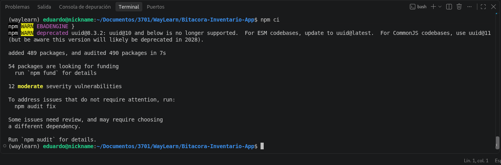

### 2.2 Ejecución de Suite de Verificación (`npm run verificar`)

El comando `npm run verificar` ejecutó exitosamente la verificación estática de tipos (`tsc -b`), **14 pruebas unitarias automatizadas**, la validación de coherencia del contrato IDL (`verificar-contrato.mjs`) y la compilación de producción con Vite (`vite build`):

* **Resultado:** `tests 14 | pass 14 | fail 0` — *Contrato coherente: IDL, Program ID y cliente generado.*
* **Evidencia visual:** 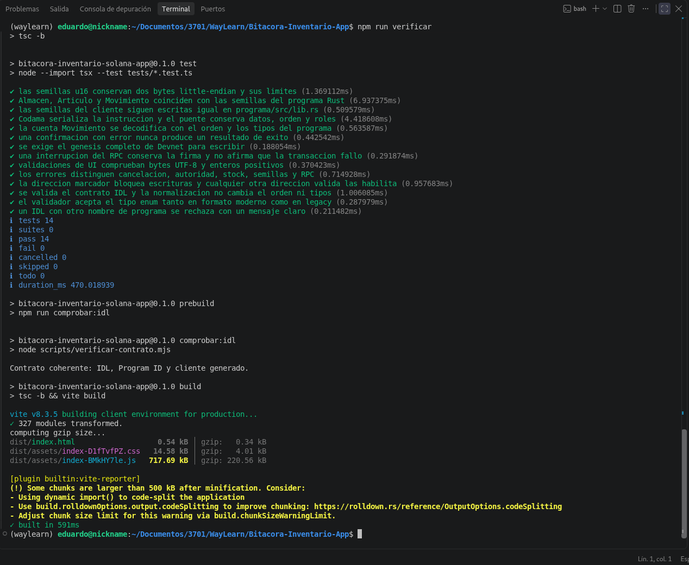

### 2.3 Despliegue de Servidor Local (`npm run dev`)

Se levantó la interfaz web en `http://localhost:5173/` conectada al RPC de Solana Devnet (`api.devnet.solana.com`) y vinculada a la wallet **Solflare** (`FLVS...bR4j`):

* **Evidencia visual (Terminal):** 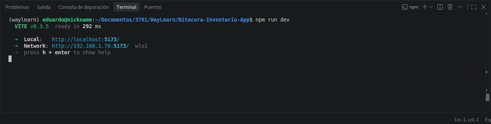
* **Evidencia visual (Interfaz inicial conectada):** 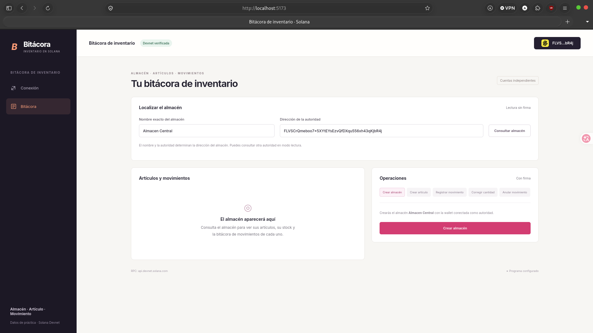

---

## 3. Pruebas de Integración On-Chain en Solana Playground (`client.ts`)

Se ejecutó el script integral `programa/client/client.ts` directamente en **Solana Playground** (`beta.solpg.io`) contra el programa desplegado en Devnet (`2pqFML2uKMCM2VDAj1gHtLcmzEvEr7o274oEf67nrLGD`).

### Resultados Validados en Consola
* **Creación de Almacén y Artículo:** Creación exitosa de almacén de prueba (`Prueba 607904`, PDA `HH3ZeFmyXZTfRPYVM8ESHdjapVX86musXkndpTeQwJiT`) y artículo #1 (`stock: 0 OK`).
* **Flujo de Inventario:** Entrada de `100` (`stock: 100 OK`), salida de `30` (`stock: 70 OK`), corrección de salida a `40` (`stock: 60 OK`) y anulación de salida (`stock: 100 OK`) con lectura de marca de tiempo desde el reloj de la red (`Clock`).
* **Validación de Errores On-Chain (Casos Negativos):**
  1. `OK, rechazado como se esperaba: salida mayor al stock` (`StockInsuficiente`)
  2. `OK, rechazado como se esperaba: cantidad cero` (`CantidadInvalida`)
  3. `OK, rechazado como se esperaba: folio repetido` (colisión de PDA existente)

* **Evidencia visual:** 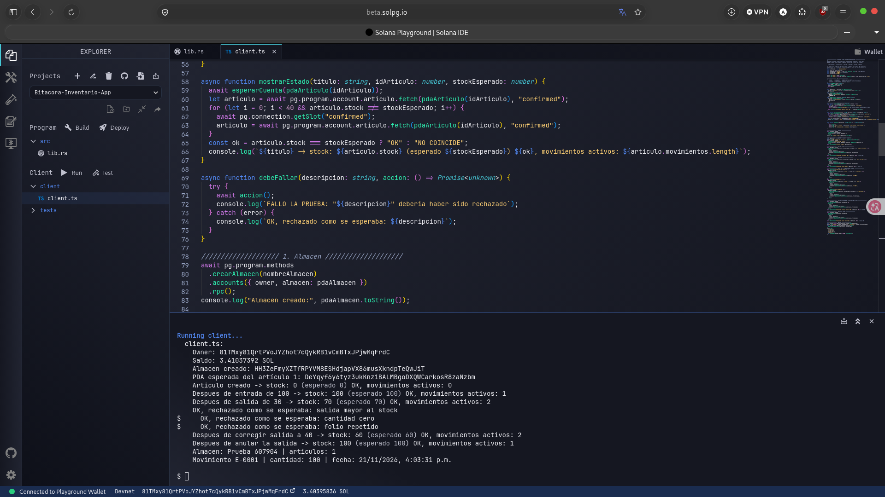

---

## 4. Matriz de Pruebas Funcionales (Manuales en Devnet)

Siguiendo el protocolo definido en `docs/PRUEBAS-MANUALES.md`, se ejecutaron los **17 casos de prueba funcionales** utilizando el almacén **`Almacen Sur`** y el artículo **`Tornillo 1/4`** (`pza`), verificando tanto el comportamiento de la interfaz como las restricciones impuestas por el contrato inteligente en Devnet.

| # | Caso de Prueba | Resultado Esperado | Resultado Observado | Estado | Evidencia |
| :-: | :--- | :--- | :--- | :-: | :--- |
| **01** | **Consultar saldo sin conectar wallet** | Lectura pública mediante RPC sin solicitar firma. | Se consultó la dirección `FLVSCr...bR4j` obteniendo `4.98061444 SOL` sin conectar wallet. | **APROBADO** | 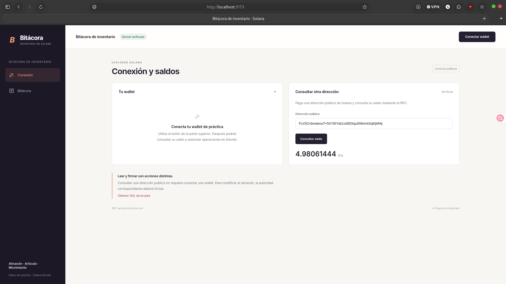 |
| **02** | **Pegar una dirección inválida** | Mensaje de error comprensible; la aplicación sigue operativa. | Se mostró la alerta *"La dirección no tiene un formato válido de Solana. Revisa lo que pegaste."* | **APROBADO** | 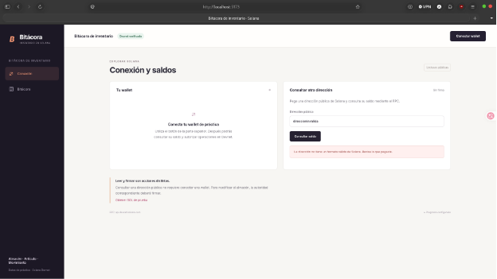 |
| **03** | **Crear almacén** | Transacción confirmada; consulta muestra `0 artículos`. | Se creó **`Almacen Sur`** con `Último ID asignado: 0` y confirmación en Explorer. | **APROBADO** | 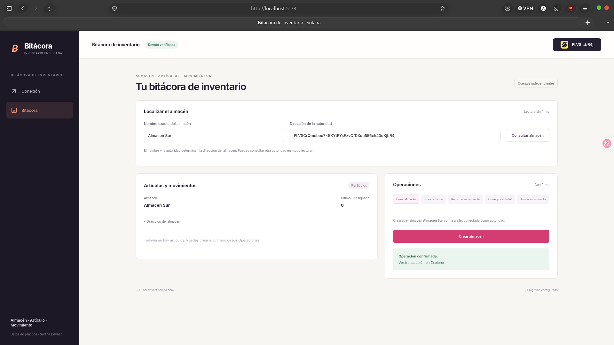 |
| **04** | **Crear artículo «Tornillo 1/4» (`pza`)** | Artículo `#1` registrado con `stock: 0`. | Se registró `Tornillo 1/4` (`Artículo #1 · Stock: 0 pza · 0 movimientos activos`). | **APROBADO** | 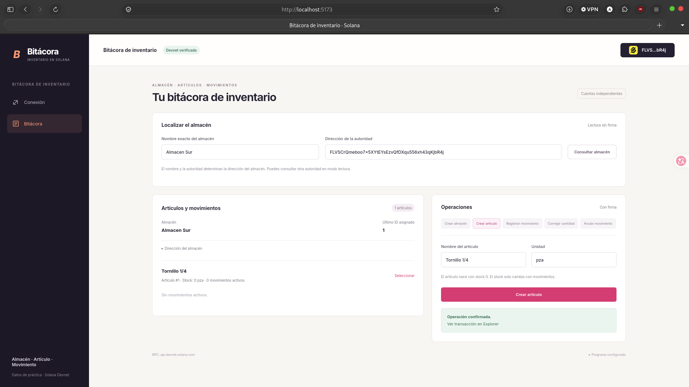 |
| **05** | **Registrar Entrada `E-0001` de `100`** | Stock actualizado a `100`; movimiento visible con fecha de red. | Stock subió a `100 pza`; movimiento `E-0001` visible con fecha `21/11/26, 4:10 p.m.` | **APROBADO** | 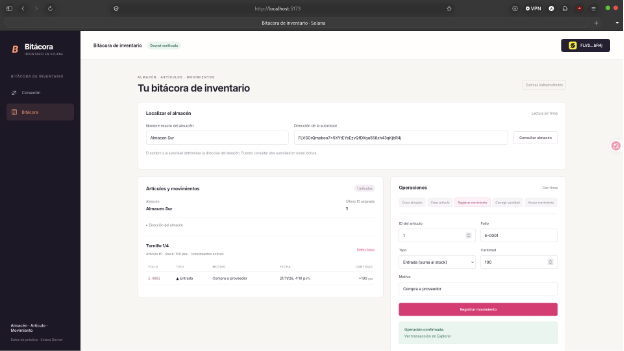 |
| **06** | **Registrar Salida `S-0001` de `30`** | Stock actualizado a `70`; movimiento visible en bitácora. | Stock bajó a `70 pza`; movimiento `S-0001` (`-30 pza`) confirmado on-chain. | **APROBADO** |  |
| **07** | **Salida `S-0002` de `1000` (Stock insuficiente)** | Rechazo con error `StockInsuficiente`; el stock permanece en `70`. | Transacción rechazada por el programa; el stock se mantuvo intacto en `70 pza`. | **APROBADO** |  |
| **08** | **Repetir folio `E-0001` activo** | Rechazo por cuenta PDA ya existente; sin duplicados. | El programa rechazó la instrucción (`Internal error` / cuenta en uso) sin duplicar el folio. | **APROBADO** | 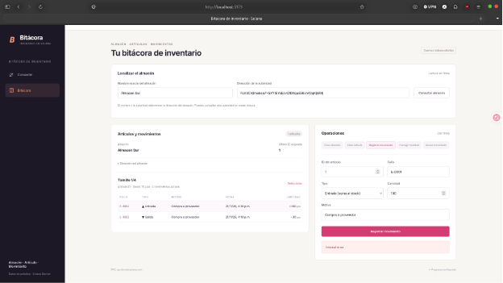 |
| **09** | **Corregir salida `S-0001` a `40`** | Recálculo de stock a `60`; conserva mismo folio y PDA. | Stock ajustado automáticamente a `60 pza`; folio `S-0001` actualizado a `-40 pza`. | **APROBADO** | 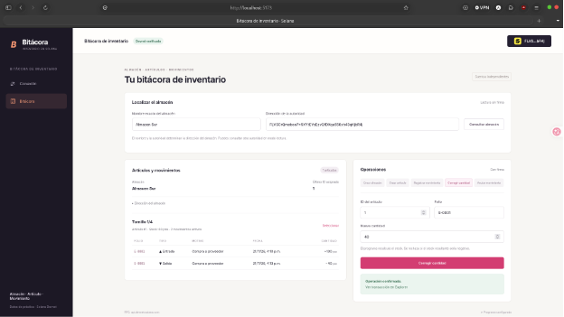 |
| **10** | **Corregir salida `S-0001` a `500`** | Rechazo con `StockInsuficiente`; el stock permanece en `60`. | Instrucción rechazada por saldo resultante negativo; stock conservado en `60 pza`. | **APROBADO** | 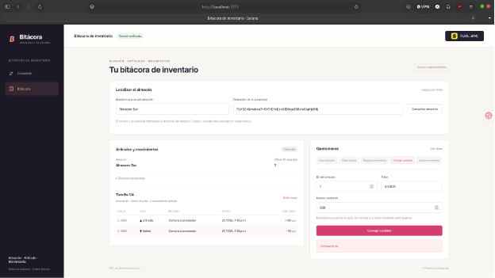 |
| **11** | **Cancelar solicitud en la wallet** | Aviso de cancelación sin marcar éxito ni alterar estado. | La UI mostró el aviso *"Transaction cancelled"* manteniendo el stock en `60 pza`. | **APROBADO** |  |
| **12** | **Anular movimiento `S-0001`** | Reversión del efecto en stock (`100`) y cierre de cuenta PDA. | Stock restaurado a `100 pza`; el folio `S-0001` desapareció de la lista de activos. | **APROBADO** | 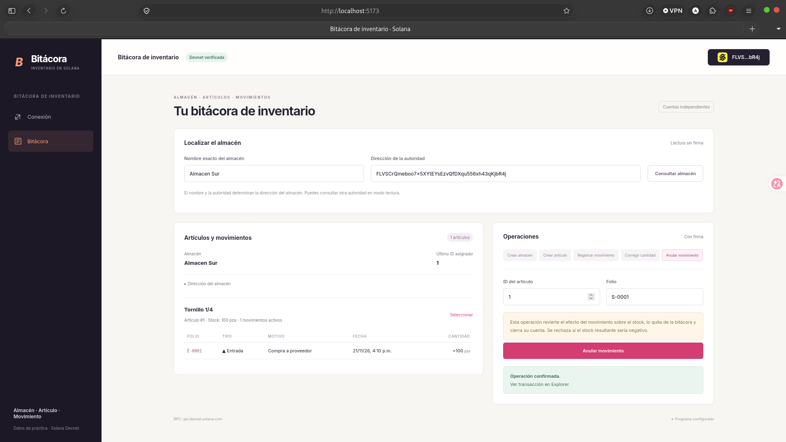 |
| **13** | **Anular entrada `E-0001` (sin salidas)** | Stock vuelve a `0` y la cuenta PDA de entrada se cierra. | Stock regresó a `0 pza` (`0 movimientos activos`) y `E-0001` fue removido. | **APROBADO** |  |
| **14** | **Reutilizar folio `E-0001` tras anulación** | Permite crear de nuevo el movimiento al haberse cerrado la PDA anterior. | Se registró nuevamente `E-0001` por `+500 pza` con confirmación exitosa en Devnet. | **APROBADO** | 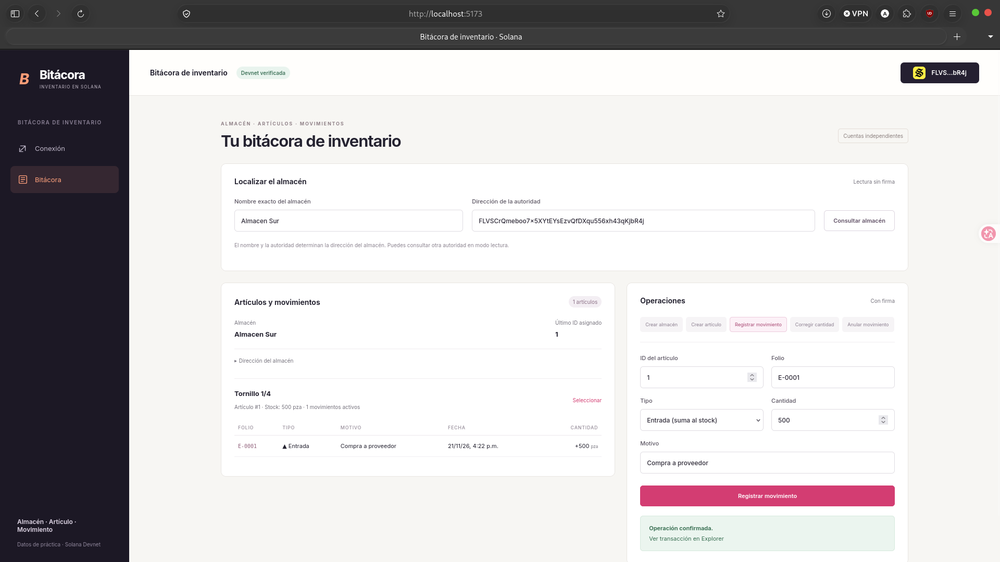 |
| **15** | **Intentar crear un 11.º artículo** | Rechazo por límite de capacidad (`LimiteArticulos` = 10). | Al intentar crear `Tornillos 3/4` (#11), la app bloqueó con *"El almacén alcanzó los 10 artículos previstos."* | **APROBADO** | 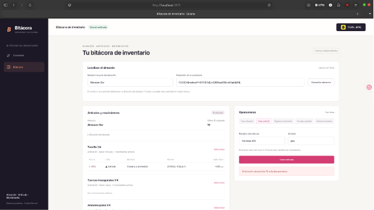 |
| **16** | **Intentar registrar un 11.º movimiento activo** | Rechazo por límite de capacidad (`LimiteMovimientos` = 10). | Con `10 movimientos activos` en `Tornillo 1/4`, el 11.º (`E-0007`) fue rechazado por el programa. | **APROBADO** | 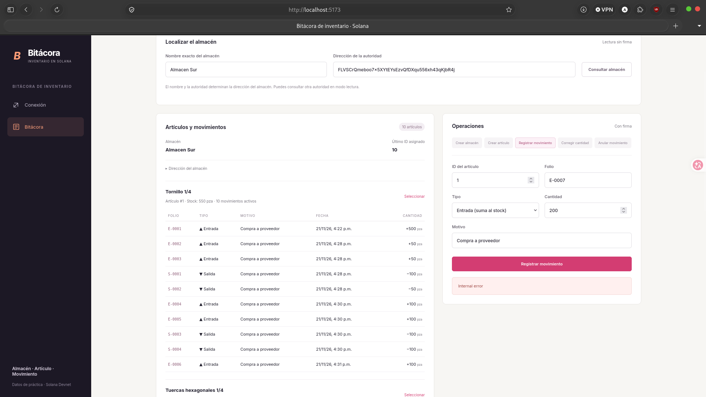 |
| **17** | **Consultar almacén de otra autoridad** | Lectura pública permitida; controles de escritura bloqueados. | Al consultar `Prueba 372769` (autoridad `81TMxy...`), se cargó en modo lectura con aviso de restricción. | **APROBADO** | 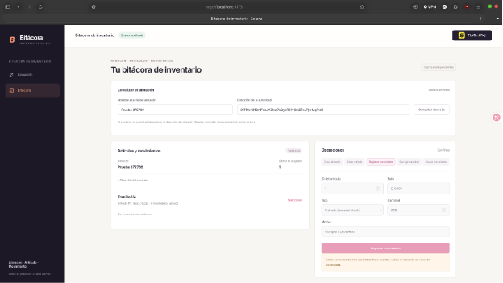 |

---